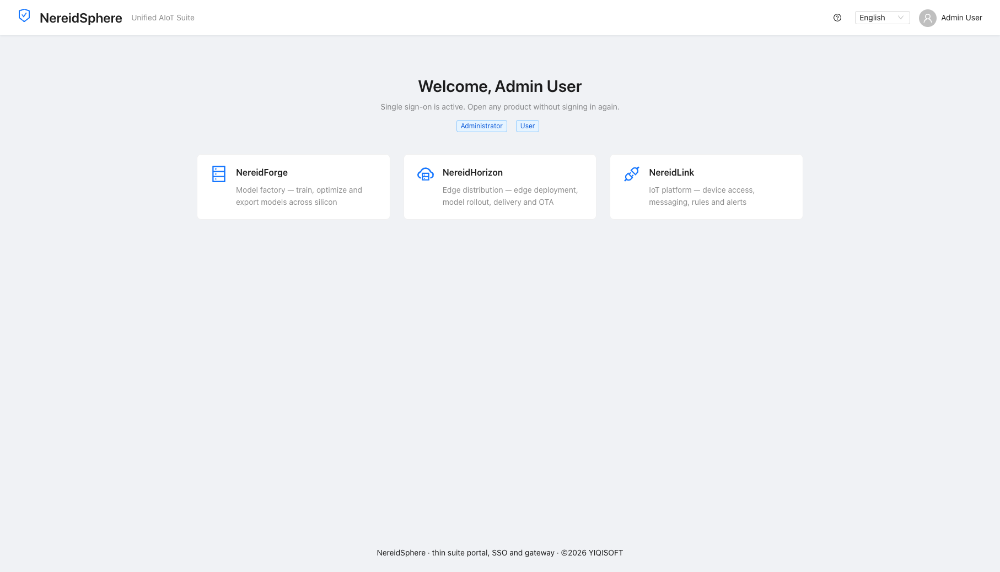

<!-- Copyright (C) 2026 YIQISOFT; SPDX-License-Identifier: Apache-2.0 -->

# NereidSphere

Thin suite layer for NereidAI: one portal, single sign-on (SSO), and a unified
API gateway. It holds no domain logic of its own. Cross-product event
integration is a planned capability, not a delivered feature.

- Without NereidSphere every product still authenticates and runs standalone.
- With it enabled, a user signs in once and opens any integrated product
  without re-authenticating.
- NereidSphere is a pure **OIDC/OAuth2 relying party** for the external
  NereidIdentity service (authorization-code + PKCE; Keycloak-compatible
  engines are supported via that one connection block). `auth.mode=local`
  provides emergency bcrypt accounts with zero external dependency.
- It also hosts the built-in account administration console, which talks to
  the identity service Admin REST API with a service-account client only.



## Architecture

| Concern | Implementation |
|---|---|
| Backend | Go 1.27.3, stdlib `net/http` (Go 1.22 routing), `log/slog`, `cobra` |
| Auth | authorization-code + PKCE against NereidIdentity (browser uses the NI login page), or emergency bcrypt local accounts; idle/absolute sliding sessions; sealed one-time ticket handoff to products |
| Admin | `nereidsphere-admin` client_credentials against NI Admin REST; user CRUD, enable/disable, reset password, suite roles; federated users read-only |
| Session | AES-256-GCM encrypted HttpOnly cookie (stateless, no session DB), transparent refresh-token renewal (oidc mode), CSRF double-submit on mutations |
| Ticket HA | memory replay for single-replica dev; Valkey Sentinel for multi-replica prod, `SET NX PX` + `WAIT 1 300`, fail-closed 503 on uncertainty |
| Gateway | reverse proxy `/p/{product}/...`, identity headers, exact-origin CORS, per-IP + local-login rate limits, timeouts, `/healthz` `/readyz` |
| API docs | embedded OpenAPI 3 spec + offline Swagger UI at `/api/docs` |
| Frontend | React 18 + antd 5 + Vite + TypeScript, embedded into the binary |

## Quick start (development)

`configs/dev.yaml` ships with `auth.mode: local` and two emergency accounts
(`admin/admin`, `user/user`), so no external dependency is required:

```bash
make web-install    # once after checkout, then whenever the lockfile changes
make dev            # terminal 1: backend at http://localhost:8081
make web-dev        # terminal 2: Vite portal at http://localhost:5174
```

Open **`http://localhost:5174`** and use the **Emergency access** form. Vite
proxies `/api`, `/auth`, and `/p` to the backend and supports hot reload. The
SSO/account-admin features are only present in oidc mode. For a production-like
local binary with the embedded portal at `http://localhost:8081`, run
`make build-local` followed by `./bin/nereidsphere serve -c configs/dev.yaml`.

### Using NereidIdentity (oidc mode)

1. Deploy NereidIdentity or a compatible Keycloak service independently. The
   example configuration expects an issuer at
   `http://localhost:8090/realms/nereidai`; choose a different issuer by editing
   `configs/dev.yaml`.
2. Through the identity provider's administrative interface, create the two
   confidential clients documented in `docs/oidc-integration.md`. Register
   `http://localhost:8081/auth/callback` for the embedded portal and
   `http://localhost:5174/auth/callback` when using Vite. Register the matching
   NS origins without trailing slashes as post-logout redirect URIs. Configure
   the role/group token claims and grant the admin service account its
   Keycloak `realm-management/realm-admin` role.
3. Copy `configs/dev.yaml` to a local file outside the repository, put the
   generated client credentials there, and set `auth.mode: "oidc"`. Start NS
   with `go run ./cmd/sphere serve -c /path/to/local.yaml`.
4. Browse the exact registered NS origin. Other hosts or ports, including LAN
   addresses, require separate exact registrations and a matching
   `server.base_url`.

The browser is redirected to the identity provider's login page; NS never sees
the upstream password. The complete provider contract and manual setup
requirements are documented in `docs/oidc-integration.md`; known gotchas live
in `docs/pitfalls.md`.

## Common targets

```bash
make verify        # complete Go, frontend and Helm CI gate
make build         # web build + self-contained linux/amd64 binary (bin/nereidsphere)
make build-local   # build for the current platform
make test          # go test ./...
make vet           # go vet
make web-typecheck # tsc --noEmit
make image         # build the three-tag image set locally (never pushes)
```

Local make targets only build and package; none of them pushes. GitHub Actions
is the only automated GHCR publication path. Release tags use `VERSION`,
`VERSION-<utc-timestamp>` and `VERSION-<git-short-sha>`, never `latest`; the
separate development workflow publishes its rolling and commit-specific tags.
Copying a local image to another registry is an explicit operator action.
Restricted networks can configure build acceleration in the git-ignored
`local.mk` (copy `local.mk.example`).

Configuration is YAML only; select a file with the binary's `-c` flag.

## Container image & Helm

Released images live at
`ghcr.io/nereidai/nereidsphere:<version>` with bare SemVer tags (`0.0.1`);
every main-branch build additionally publishes the rolling `0.0.0-dev` tag.
The image is self-contained — the SPA is embedded in the binary. The Dockerfile
builds web assets and the binary in one stage and ships a small Alpine 3.24.4
runtime image. Override the registry with `REGISTRY=... make image` for a
local or internal build.

```bash
# Default: NereidIdentity via authorization-code + PKCE
helm install nereidsphere deploy/helm -n nereidsphere --create-namespace \
  --set config.server.baseUrl=https://nereidsphere.example.com \
  --set config.oidc.issuer=https://sso.example.com/auth/realms/nereidai \
  --set config.oidc.clientSecret=<nereidsphere-client-secret> \
  --set config.oidc.adminClientSecret=<nereidsphere-admin-sa-secret> \
  --set config.session.secretKey=<exactly-32-bytes> \
  --set valkey.auth.password=<strong-valkey-password>

# Emergency mode: local bcrypt accounts instead of the identity plane
helm install nereidsphere deploy/helm -n nereidsphere --create-namespace \
  --set replicaCount=1 \
  --set valkey.enabled=false \
  --set tickets.replayStore=memory \
  --set config.auth.mode=local \
  --set 'config.auth.localUsers[0].username=admin' \
  --set 'config.auth.localUsers[0].passwordBcrypt=$2a$10$...'
```

The chart renders the runtime YAML into a Secret mounted at
`/app/config/config.yaml`; use `config.existingSecret` to supply your own.
`auth.mode=oidc` (default) requires `issuer`/`clientId`/`clientSecret` plus
the `adminClientId`/`adminClientSecret` service-account pair; the default
two-replica topology also requires `valkey.auth.password` or
`valkey.auth.existingSecret`. `local` requires at least one
`config.auth.localUsers` entry and is normally run single replica with
`tickets.replayStore=memory`. Replace every `changeme`/`change-me`
placeholder (client secrets, 32-byte session key, Valkey password, per-product
SSO secrets) before a real deployment, and set `imagePullSecrets` if the
registry requires auth.

There is no VERSION file: the git tag is the single version source. On an
exact `v*` tag checkout the Makefile derives bare SemVer (`v0.0.1` →
`0.0.1`) for both the chart version and appVersion; any other checkout uses
the rolling `0.0.0-dev` channel.

```bash
make helm-package   # lint + package dist/charts/nereidsphere-<version>.tgz
# Optional air-gapped redistribution through an explicit ChartMuseum is an
# operator action outside the Makefile (no push targets):
# curl -f --data-binary @dist/charts/nereidsphere-<version>.tgz \
#      <chartmuseum-url>/api/charts
```

## CI and image publication

`.github/workflows/ci.yml` runs on pushes and pull requests to `main`. It uses
no secrets and executes the same `make helm-dep` and `make verify` gates as a
local checkout, and warms the multi-arch image build cache with the
`VERSION=0.0.0-dev` build argument.

`.github/workflows/publish-dev.yml` runs on every push to `main` and
publishes the rolling `0.0.0-dev` floating tag plus an immutable
`0.0.0-dev-<sha>` tag; pull requests never publish.

`.github/workflows/release.yml` runs only when a `v*` tag is pushed. The
organization workflow validates the SemVer shape of the tag, derives the bare
VERSION itself and publishes the three-tag set
`ghcr.io/nereidai/nereidsphere:<version>`, `:<version>-<utc-timestamp>` and
`:<version>-<git-short-sha>` (no `latest`) with the built-in `GITHUB_TOKEN`,
and the caller creates the GitHub Release. Release publication is
maintainer-only. After release approval, create and push a new signed tag;
existing tags must never be moved or reused. For example, when `v0.1.0` is the
approved next version:

```bash
release=v0.1.0
git tag -s "$release" -m "NereidSphere $release"
git push origin "$release"
```

After the first release, set the new GHCR package to **Public** once in the
organization package settings. Internal registry delivery is never performed
by GitHub Actions.

## SSO model

In oidc mode the browser is redirected from `/auth/login` to the
NereidIdentity login page and back to `/auth/callback` over
authorization-code + PKCE; NS verifies the id token against JWKS and sets a
sealed `ns_session` cookie. The upstream password and tokens are never
exposed to JavaScript. In local mode an explicitly labeled emergency form
posts to the local-account login endpoint.

Jumping to a product goes through `/auth/enter/{product}`: mode `ns`
(default) mints a 30-second, single-use, audience-bound sealed ticket that
the product backend exchanges server to server for the verified identity
(`X-NS-Client-Id/Secret` authenticated). Multi-replica installs claim the
ticket JTI in shared Valkey and fail closed if the claim or replica
acknowledgement cannot be confirmed; mode `oidc` redirects straight to the
standalone product client. The portal order reflects the closed loop:
**Forge → Horizon → Link**; NereidEdge runs independently at each edge site
and is not a central portal entry. See `docs/sso-flow.md` for the full
contract and `FEATURES.md` for the feature inventory.

Edge hardening includes exact-origin CORS, per-IP rate limits, a stricter
limit on the local login endpoint, CSRF double-submit on browser mutations,
browser security headers, upstream timeouts, an ingress forward-auth
endpoint (`GET /api/v1/auth/verify`, 204 + identity headers / 401), and an
embedded OpenAPI/Swagger UI at `/api/docs`; see `docs/gateway.md`.

## Acknowledgments

NereidSphere builds on the work of these open-source projects and their
contributors:

- [coreos/go-oidc](https://github.com/coreos/go-oidc) (Apache-2.0),
  [golang.org/x/oauth2](https://pkg.go.dev/golang.org/x/oauth2), and
  [golang.org/x/crypto](https://pkg.go.dev/golang.org/x/crypto) (BSD-3-Clause)
  support standards-based authentication and cryptography.
- [Cobra](https://github.com/spf13/cobra) (Apache-2.0) and
  [yaml.v3](https://github.com/go-yaml/yaml) (MIT/Apache-2.0) provide the CLI
  and YAML configuration foundations.
- [React](https://react.dev/), [Ant Design](https://ant.design/),
  [axios](https://axios-http.com/), [i18next](https://www.i18next.com/), and
  [Zustand](https://github.com/pmndrs/zustand) (MIT) support the portal UI.
- [Vite](https://vite.dev/) (MIT) and
  [TypeScript](https://www.typescriptlang.org/) (Apache-2.0) provide the
  frontend build and type-checking toolchain.
- [Swagger UI](https://github.com/swagger-api/swagger-ui) (Apache-2.0) renders
  the embedded OpenAPI documentation.

See `NOTICE` and `THIRD_PARTY_NOTICES` for attributions and license details.
These projects do not endorse NereidSphere or YIQISOFT.
