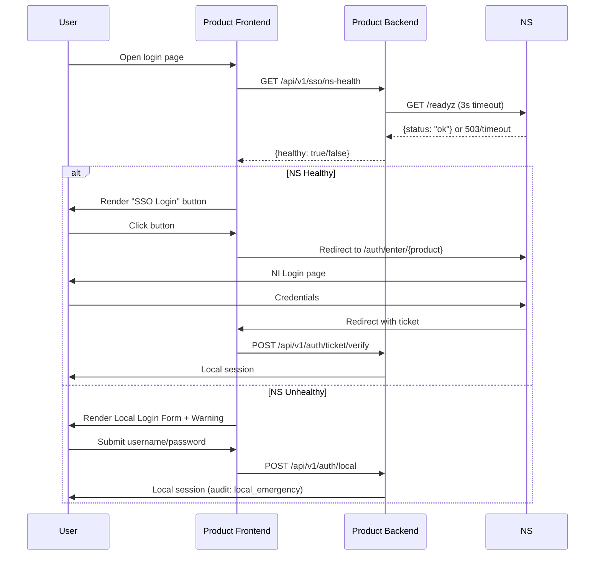

<!-- Copyright (C) 2026 YIQISOFT; SPDX-License-Identifier: Apache-2.0 -->

# Emergency Local Login when NS is Unavailable

## Problem

All suite products (NereidLink, NereidForge, NereidHorizon) run in **`mode: ns`** (ticket-based SSO via NereidSphere). When NS is down (maintenance, failure, network partition), users cannot log in through the suite portal.

## Solution

Each product independently detects NS health via `GET /readyz` and gracefully degrades to **local emergency login** when NS is unhealthy.

---

## NS Side: `/readyz` Contract

**Endpoint**: `GET https://nereidsphere.example.com/readyz`

**No auth required** (public, cacheable, low latency).

### Response (healthy)

```json
{
  "auth": "oidc",
  "replay": "valkey",
  "status": "ok"
}
```

| Field | Values | Meaning |
|-------|--------|---------|
| `auth` | `oidc` \| `local` | NS authentication mode |
| `replay` | `valkey` \| `memory` | Ticket replay store backend |
| `status` | `ok` \| `degraded` \| `down` | Overall health |

### Response (unhealthy)

```json
{
  "auth": "oidc",
  "replay": "valkey",
  "status": "down",
  "reason": "valkey unavailable"
}
```

Or HTTP `503 Service Unavailable` with same JSON body.

### Response (maintenance window - optional)

```json
{
  "auth": "oidc",
  "replay": "valkey",
  "status": "maintenance",
  "maintenance_until": "2026-10-15T12:00:00Z",
  "message": "Scheduled maintenance, expected recovery 12:00 UTC"
}
```

---

## Product Side Integration Guide

### 1. Health Check Endpoint (each product implements)

```
GET /api/v1/sso/ns-health
```

**Purpose**: Avoid CORS issues, allow server-side caching, hide NS URL from browser.

**Implementation** (pseudo-code):
```go
func NSHealthHandler(w http.ResponseWriter, r *http.Request) {
    ctx, cancel := context.WithTimeout(r.Context(), 3*time.Second)
    defer cancel()

    resp, err := httpClient.Get(ctx, nsBaseURL + "/readyz")
    if err != nil || resp.StatusCode != 200 {
        writeJSON(w, NSHealth{Healthy: false, Error: err.Error()})
        return
    }
    var data NSReadyzResponse
    json.NewDecoder(resp.Body).Decode(&data)
    writeJSON(w, NSHealth{
        Healthy:  data.Status == "ok",
        AuthMode: data.Auth,
        Replay:   data.Replay,
        Error:    data.Reason,
    })
}
```

**Response**:
```json
{ "healthy": true, "auth_mode": "oidc", "replay": "valkey" }
```
```json
{ "healthy": false, "error": "timeout" }
```

### 2. Frontend Login Page Logic

```tsx
// On login page mount
const [nsHealth, setNsHealth] = useState(null);

useEffect(() => {
  const check = async () => {
    try {
      const res = await fetch('/api/v1/sso/ns-health');
      const data = await res.json();
      setNsHealth(data);
    } catch (e) {
      setNsHealth({ healthy: false, error: e.message });
    }
  };
  check();
  const timer = setInterval(check, 30000); // Poll every 30s
  return () => clearInterval(timer);
}, []);

// Render
if (nsHealth?.healthy) {
  // Normal: SSO button → redirects to NS /auth/enter/{product}
  return <Button onClick={startSSO}>通过 NereidSphere 统一登录</Button>;
} else {
  // Degraded: Show local login form (only if product has local accounts configured)
  return (
    <>
      <Alert type="warning">
        SSO 服务不可用，已切换到本地应急登录
        {nsHealth?.error && <span>：{nsHealth.error}</span>}
      </Alert>
      <LocalLoginForm />
    </>
  );
}
```

### 3. Local Emergency Accounts (product must pre-provision)

| Product | Config Location | Required Fields |
|---------|----------------|-----------------|
| **NereidLink** | `auth.local_users` in config.yaml / Helm values | `username`, `password_bcrypt`, `roles` |
| **NereidForge** | DB bootstrap (migration) or `auth.local_users` | `username`, `password_hash`, `roles`, `tenant_id` |
| **NereidHorizon** | `oidc.enabled: false` + local user table | `username`, `password_hash`, `roles` |

**Deployment rule**: Every production deployment **must** include at least one local emergency account with admin role.

### 4. Audit Logging

Local logins **must** be distinguishable from SSO logins:

```json
{
  "event": "user_login",
  "method": "local_emergency",  // NOT "sso_ticket" or "oidc"
  "username": "emergency-admin",
  "tenant_id": "default",
  "timestamp": "2026-10-15T10:30:00Z"
}
```

---

## NS Enhancements (Future)

### 1. Maintenance Mode Flag

Add to NS config:
```yaml
maintenance:
  enabled: false
  message: "Scheduled maintenance"
  until: "2026-10-15T12:00:00Z"
```

When enabled, `/readyz` returns `status: maintenance` with `maintenance_until` and `message`.

### 2. Product Health Registry (Optional)

NS could expose `GET /api/v1/admin/products/health` aggregating each product's self-reported health (if products push heartbeats). Not required for MVP.

---

## Deployment Checklist

- [ ] NS `/readyz` returns correct JSON (already done)
- [ ] Each product implements `/api/v1/sso/ns-health` proxy
- [ ] Each product frontend degrades to local login form on NS unhealthy
- [ ] Each product has ≥1 local emergency admin account in production deployment
- [ ] Local login audit logs tagged `method: local_emergency`
- [ ] Runbook documents: "NS down → access products directly at their domains"

---

## Sequence Diagram



---

## References

- NS `/readyz` implementation: `internal/auth/handlers.go` → `readyHandler`
- Ticket verify: `internal/auth/handlers.go` → `verifyTicket`
- Product SSO integration: each product's `sso` package